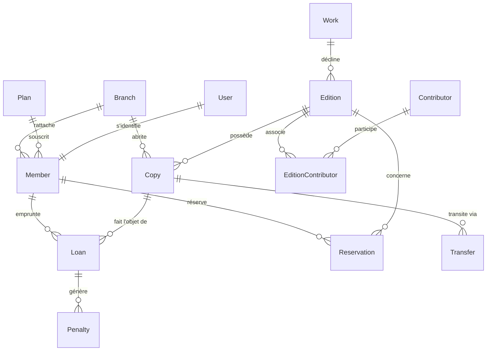

# Modèle de Données — Réseau de Médiathèques

Ce document présente l'architecture des données, le schéma conceptuel et la justification des choix de modélisation du domaine.

---

## 1. Vocabulaire du Domaine

| Concept Métier (FR) | Entité / Table (EN) | Définition & Rôle |
|---|---|---|
| **Site / Médiathèque** | `Branch` | L'un des deux établissements physiques du réseau. |
| **Œuvre** | `Work` | Entité abstraite représentant la création intellectuelle (ex: *Les Misérables*). |
| **Édition** | `Edition` | Publication concrète d'une œuvre (ISBN, éditeur, format : livre, BD, DVD). |
| **Contributeur** | `Contributor` | Personne physique ou morale (auteur, scénariste, réalisateur, traducteur...). |
| **Contribution** | `EditionContributor` | Relation liant un contributeur à une édition avec un rôle précis et un ordre. |
| **Exemplaire** | `Copy` | Objet physique numéroté (code-barres unique), rattaché à une médiathèque et doté d'un statut. |
| **Adhérent** | `Member` | Usager de la médiathèque lié à un compte `User`, avec une formule d'abonnement et un site de rattachement. |
| **Formule d'abonnement** | `Plan` | Règles de tarification (durée maximale de prêt, quota d'emprunts simultanés, tarif journalier de pénalité). |
| **Compte Utilisateur** | `User` | Authentification (email, mot de passe hashé, rôles : `ROLE_MEMBER`, `ROLE_LIBRARIAN`, `ROLE_ADMIN`). |
| **Prêt** | `Loan` | Emprunt d'un exemplaire par un adhérent avec dates d'emprunt, d'échéance et de retour effectif. |
| **Réservation** | `Reservation` | Réservation d'une édition par un adhérent avec file d'attente FIFO et site de retrait souhaité. |
| **Pénalité** | `Penalty` | Montant dû suite à un retard, une dégradation ou la perte d'un document. |
| **Transfert** | `Transfer` | Déplacement d'un exemplaire entre deux médiathèques pour honorer une réservation ou un rééquilibrage. |

---

## 2. Diagramme Conceptuel (Mermaid)

> *Le diagramme complet des relations sera validé et complété lors de l'Étape 3.*

---

## 3. Grands Choix de Conception

1. **Distinction Œuvre vs Édition vs Exemplaire** :
   - Une *Œuvre* regroupe les différentes adaptations ou rééditions.
   - Une *Édition* porte les métadonnées bibliographiques fixes (ISBN, éditeur, année de publication, type de média).
   - Un *Exemplaire* représente l'unité physique manipulée par les bibliothécaires et les adhérents, identifiée par son code-barres unique.
2. **Réservation rattachée à l'Édition** :
   - L'adhérent réserve une édition particulière (ex: un format précis ou une traduction spécifique). La file d'attente est ordonnée par date de création (FIFO).
3. **Immutabilité des Dates & Historisation** :
   - Utilisation de `DateTimeImmutable` stocké en UTC.
