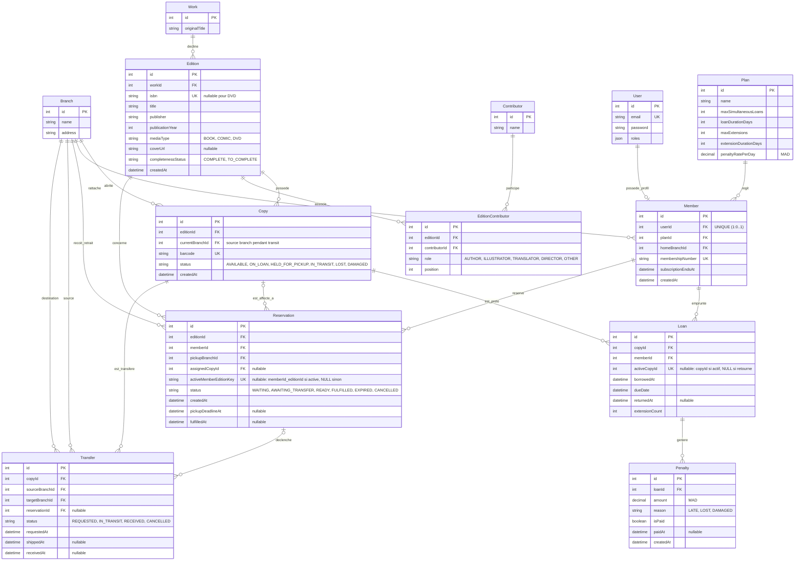

# Modèle de Données — Réseau de Médiathèques

Ce document présente l'architecture des données, le schéma relationnel complet (13 entités), les contraintes d'intégrité, les enums du domaine, les verrous de concurrence et les justifications conceptuelles.

---

## 1. Vocabulaire du Domaine (Lexique Bilingue)

| Concept Métier (FR) | Entité / Table (EN) | Définition & Rôle |
|---|---|---|
| **Site / Médiathèque** | `Branch` | L'un des deux établissements physiques du réseau. |
| **Œuvre** | `Work` | Création intellectuelle abstraite (ex: *Les Misérables*). |
| **Édition** | `Edition` | Publication concrète d'une œuvre (ISBN, éditeur, année, format). |
| **Contributeur** | `Contributor` | Personne physique ou morale (auteur, traducteur, illustrateur...). |
| **Contribution** | `EditionContributor` | Relation liant un contributeur à une édition avec un rôle et un ordre. |
| **Exemplaire** | `Copy` | Support physique identifié par un code-barres unique, rattaché à un site. |
| **Formule d'abonnement** | `Plan` | Règles de prêt (durée, quota, extensions autorisées, taux de pénalité). |
| **Compte Utilisateur** | `User` | Authentification (email, mot de passe hashé, rôles de sécurité). |
| **Adhérent** | `Member` | Usager de la médiathèque lié à un compte `User`, avec un abonnement et un site de rattachement. |
| **Prêt** | `Loan` | Emprunt d'un exemplaire par un adhérent avec dates d'échéance et de retour. |
| **Réservation** | `Reservation` | Réservation d'une édition avec file d'attente FIFO et site de retrait. |
| **Pénalité** | `Penalty` | Montant dû suite à un retard, une détérioration ou la perte d'un document. |
| **Transfert** | `Transfer` | Acheminement d'un exemplaire entre deux médiathèques. |

---

## 2. Diagramme Conceptuel Complet (13 Entités — Mermaid ERD)



---

## 3. Choix de Conception et Justifications Métier

1. **Séparation Œuvre (`Work`) / Édition (`Edition`)** :
   - Conforme à la norme FRBR (Functional Requirements for Bibliographic Records).
   - Une *Œuvre* matérialise la création intellectuelle abstraite (ex: *Le Petit Prince* d'Antoine de Saint-Exupéry).
   - Une *Édition* porte les attributs physiques et bibliographiques spécifiques (ISBN, format livre/BD/DVD, éditeur Gallimard/Folio, année de publication).
   - Cette distinction permet de rattacher plusieurs formats ou rééditions à une même création sans dupliquer l'identité fondamentale de l'œuvre.
2. **Réservation ciblée sur l'Édition (`Edition`)** :
   - L'usager réserve une édition précise (format, langue, traducteur ou jaquette recherchée) plutôt qu'une œuvre globale ou un exemplaire physique unique.
   - Dès qu'un exemplaire quelconque de cette édition devient disponible ou est restitué, il satisfait la réservation selon la file FIFO.
   - **Invariant structurel** : Une file d'attente active (réservations au statut `WAITING`) n'existe que si **aucun exemplaire de l'édition n'est disponible dans tout le réseau** (car tout exemplaire disponible localement déclenche le statut `READY`, et tout exemplaire disponible sur l'autre site déclenche immédiatement l'assignation, le transfert et le statut `AWAITING_TRANSFER`).
3. **Table pivot de contribution (`EditionContributor`)** :
   - Permet de gérer les œuvres multi-auteurs (co-auteurs, anthologies) et les créations collaboratives (ex: scénariste et dessinateur pour une bande dessinée, réalisateur et scénariste pour un DVD).
   - Attribut `role` (enum `ContributorRole` : `AUTHOR`, `ILLUSTRATOR`, `TRANSLATOR`, `DIRECTOR`, `OTHER`).
   - Attribut `position` (entier) pour respecter l'ordre officiel d'apparition des crédits sur les fiches bibliographiques.
4. **Monnaie et Précision Financière** :
   - La monnaie officielle retenue pour le projet est le **Dirham Marocain (MAD)**, conformément au cadre de travail d'Education Media Company à Agadir.
   - Les montants de pénalité et tarifs journaliers sont strictement stockés en type **`DECIMAL(10,2)`**. L'utilisation des nombres à virgule flottante (`float`/`double`) est formellement proscrite pour éviter les dérives d'arrondi binaire.
5. **Horodatage et Fuseaux Horaires** :
   - Toutes les dates sont instanciées sous forme de **`DateTimeImmutable`** en temps universel coordonné (**UTC**) en base de données.
   - L'affichage dans l'interface utilisateur s'effectue dans le fuseau horaire du Maroc (`Africa/Casablanca`).
6. **Entité dédiée pour les Transferts (`Transfer`)** :
   - Un transfert physique entre deux sites possède son cycle de vie propre (`REQUESTED`, `IN_TRANSIT`, `RECEIVED`, `CANCELLED`), des horodatages de traçabilité (`requestedAt`, `shippedAt`, `receivedAt`), et peut exister indépendamment d'une réservation (ex: rééquilibrage de stock entre médiathèques).
   - La valeur `Transfer.status = REQUESTED` signifie « en attente d'expédition » (ordre de transfert émis, exemplaire mis de côté et retiré de la circulation, impossible à emprunter par un tiers).
7. **Localisation d'un exemplaire en transit et gestion des annulations** :
   - Lorsqu'un exemplaire passe au statut `IN_TRANSIT`, **`Copy.currentBranchId` conserve l'identifiant du site source** (lieu physique de départ) jusqu'à ce que le bibliothécaire du site récepteur valide la réception (`Transfer.status = RECEIVED`), moment où `Copy.currentBranchId` bascule vers le site de destination et où `Copy.status` devient `HELD_FOR_PICKUP` (ou `AVAILABLE`).
   - **Annulation en cours de transit** : Si un adhérent annule sa réservation alors que le document est déjà expédié (`IN_TRANSIT`), le transfert physique ne peut être stoppé en cours de route. À l'arrivée sur le site de destination (`Transfer.status = RECEIVED`), le système constate l'annulation : si un autre adhérent attend cette édition sur ce site, elle lui est immédiatement allouée (`READY`, délai de 5 jours) ; sinon, l'exemplaire devient `AVAILABLE` dans le catalogue local du site d'arrivée.
8. **Relation Utilisateur-Adhérent (`User ||--o| Member`)** :
   - Relation optionnelle `0..1` : un compte utilisateur (`User`) peut être un administrateur (`ROLE_ADMIN`) ou un bibliothécaire (`ROLE_LIBRARIAN`) sans posséder de profil lecteur (`Member`).

---

## 4. Périmètre Volontairement Minimal (Arbitrages "Challenge 2 Jours")

Pour garantir un niveau de qualité irréprochable sans dispersion dans le budget temps imparti :
- **Entité `Transfer`** : Cycle logistique minimal en 4 états sans gestion de colisage multi-exemplaires ni transporteurs externes.
- **Rôles de contribution secondaires** : Prise en charge des illustrateurs, traducteurs et réalisateurs pour la recherche et l'affichage des notices, sans modules complexes de gestion des droits d'auteur.
- **Entité `Branch`** : Limitée aux deux établissements du réseau avec leurs coordonnées essentielles.

---

## 5. Détail des Entités Clés

### `Plan` (Formule d'abonnement)
- `id` (int PK) : Identifiant.
- `name` (string) : Nom commercial (ex: *Standard*, *Jeunesse*, *Privilège*).
- `maxSimultaneousLoans` (int) : Nombre maximum d'exemplaires empruntables simultanément.
- `loanDurationDays` (int) : Durée autorisée d'un prêt en jours calendaires.
- `maxExtensions` (int) : Nombre maximum de prolongations autorisées par prêt.
- `extensionDurationDays` (int) : Durée de chaque prolongation en jours.
- `penaltyRatePerDay` (decimal 10,2) : Tarif journalier appliqué par jour de retard en MAD.

### `Member` (Adhérent)
- `id` (int PK) : Identifiant.
- `userId` (int FK, UNIQUE) : Relation OneToOne optionnelle côté User (`User 1:0..1 Member`).
- `planId` (int FK) : Formule souscrite déterminant les quotas et durées.
- `homeBranchId` (int FK) : Médiathèque principale d'inscription.
- `membershipNumber` (string, UNIQUE) : Numéro de carte lecteur unique (ex: `ADH-2026-0001`).
- `subscriptionEndsAt` (DateTimeImmutable) : Date et heure d'expiration de l'adhésion.
- `createdAt` (DateTimeImmutable) : Horodatage d'inscription.

### `Penalty` (Pénalité)
- `id` (int PK) : Identifiant.
- `loanId` (int FK) : Emprunt concerné.
- `amount` (decimal 10,2) : Montant en MAD (jamais de float).
- `reason` (enum `PenaltyReason`) :
  - `LATE` : Retard de restitution (calculé : `jours de retard * taux journalier du forfait`).
  - `LOST` : Déclaration de perte d'un exemplaire.
  - `DAMAGED` : Exemplaire restitué abîmé nécessitant réparation ou remplacement.
- `isPaid` (boolean) : Statut de règlement (`false` par défaut).
- `paidAt` (DateTimeImmutable, nullable) : Date de règlement effectif.
- `createdAt` (DateTimeImmutable) : Date d'émission de la pénalité.

### `Reservation` (Réservation)
- `id` (int PK) : Identifiant.
- `editionId` (int FK) : Édition demandée.
- `memberId` (int FK) : Adhérent demandeur.
- `pickupBranchId` (int FK) : Médiathèque choisie pour le retrait.
- `assignedCopyId` (int FK, nullable) : Exemplaire physique affecté dès qu'il est réservé/rapatrié.
- `activeMemberEditionKey` (string, nullable, UNIQUE) : Clé de verrouillage base de données (vaut `"memberId_editionId"` tant que la réservation est active sous statut `WAITING`, `AWAITING_TRANSFER` ou `READY` ; réinitialisée à `NULL` dès qu'elle est terminée sous statut `FULFILLED`, `EXPIRED` ou `CANCELLED`).
- `status` (enum `ReservationStatus`) :
  - `WAITING` : En attente dans la file FIFO (aucun exemplaire n'est encore disponible ni assigné).
  - `AWAITING_TRANSFER` : Exemplaire physique assigné et en cours de transfert vers le site de retrait choisi (`Transfer.status = IN_TRANSIT`).
  - `READY` : Exemplaire arrivé et disponible au site de retrait ; compte à rebours de 5 jours enclenché.
  - `FULFILLED` : Exemplaire retiré par l'adhérent (transformé en prêt effectif).
  - `EXPIRED` : Délai de 5 jours dépassé sans retrait (exemplaire réaffecté au suivant ou libéré).
  - `CANCELLED` : Annulée par l'adhérent ou le personnel.
- `createdAt` (DateTimeImmutable) : Horodatage d'inscription pour l'ordre FIFO strict.
- `pickupDeadlineAt` (DateTimeImmutable, nullable) : Date/heure limite de retrait (`date d'arrivée effective au site de retrait + 5 jours`).
- `fulfilledAt` (DateTimeImmutable, nullable) : Horodatage de retrait.

---

## 6. Contraintes d'Intégrité & Stratégie d'Indexation

### Contraintes d'Unicité (UNIQUE)
1. `User.email` : Unicité stricte des comptes utilisateurs.
2. `Edition.isbn` : Unicité de l'ISBN (nullable pour autoriser les DVD dépourvus d'ISBN).
3. `Copy.barcode` : Unicité du code-barres physique.
4. `Member.userId` : Unicité garantissant qu'un compte utilisateur ne peut avoir qu'un seul profil adhérent.
5. `Member.membershipNumber` : Unicité du numéro d'adhérent.
6. `Loan.activeCopyId` : Unicité garantissant physiquement au niveau SGBD qu'un exemplaire ne peut avoir qu'un seul prêt actif à la fois.
7. `Reservation.activeMemberEditionKey` : Unicité garantissant physiquement au niveau SGBD qu'un adhérent ne peut avoir qu'une seule réservation active (`WAITING`, `AWAITING_TRANSFER`, `READY`) sur une édition donnée.
8. `EditionContributor.(edition_id, contributor_id, role)` : Unicité interdisant les doublons de rôle pour un même contributeur sur une même édition.

### Index de Recherche et Clés Étrangères
- **Clés étrangères** : Index B-Tree systématiques sur l'ensemble des colonnes de liaison (`work_id`, `edition_id`, `copy_id`, `member_id`, `plan_id`, `branch_id`, etc.).
- **Contrôle de quota d'emprunt** :
  - `Loan.(member_id, returned_at)` : Index composite essentiel pour compter instantanément le nombre d'emprunts en cours d'un adhérent (`WHERE member_id = :id AND returned_at IS NULL`) lors de la vérification du quota.
- **Recherche Catalogue sur `Edition.title`** :
  - *Note technique* : Un index B-Tree classique n'accélère pas les recherches par sous-chaîne `LIKE '%terme%'`. Cependant, pour le volume du réseau (~8 000 notices), le temps de parcours d'une table complète en mémoire sous MySQL 8 est négligeable pour ~8 000 notices. L'index B-Tree sur `title` accélère les tris alphabétiques et les recherches par préfixe `LIKE 'terme%'`, tandis qu'un index `FULLTEXT` pourra être configuré pour les recherches multi-mots.
- **Index de Requêtes Métier Fréquentes** :
  - `Copy.status` : Index pour filtrer les exemplaires en rayon.
  - `Loan.due_date` : Index pour identifier rapidement les retards.
  - `Reservation.(edition_id, status, created_at)` : Index composite pour la sélection immédiate du premier réservant FIFO.
  - `Reservation.pickup_deadline_at` : Index pour la commande de purge des réservations expirées.
  - `Transfer.status` : Index pour la liste de travail logistique des bibliothécaires.

---

## 7. Règles d'Intégrité Concurrente sous MySQL 8

### A. Règle « Un seul prêt actif par exemplaire » et respect strict du quota adhérent
- **Problématique 1 (Double prêt concurrent)** : Deux requêtes simultanées tentant d'emprunter le même exemplaire.
- **Problématique 2 (Dépassement concurrent du quota)** : Deux requêtes simultanées pour un même adhérent qui a droit à 1 dernier prêt peuvent toutes deux lire un quota non atteint et insérer deux nouveaux prêts, dépassant le forfait autorisé.
- **Architecture de protection et ordre déterministe des verrous** :
  1. **Ordre strict des verrous (Anti-Deadlock)** : Toute opération d'emprunt dans `LoanService::borrow()` s'exécute dans `wrapInTransaction()` et applique un ordre immuable d'acquisition des verrous :
     - **Étape 1 : Verrouillage de l'Adhérent (`Member`)** via `LockMode::PESSIMISTIC_WRITE`. Le service compte ses prêts actifs avec l'index `Loan.(member_id, returned_at)`. Si le quota du forfait est déjà atteint, l'opération échoue immédiatement avec `LoanQuotaExceededException`.
     - **Étape 2 : Verrouillage de l'Exemplaire (`Copy`)** via `LockMode::PESSIMISTIC_WRITE`. Le service vérifie que `Copy.status === AVAILABLE`.
     - *Bénéfice anti-interblocage* : L'ordre immuable (Member d'abord, Copy ensuite) élimine tout risque de deadlock croisé entre transactions concurrentes.
  2. **Niveau Base de Données (Filet de sécurité physique)** : La table `loan` intègre une colonne nullable `active_copy_id` protégée par une contrainte `UNIQUE (active_copy_id)`.
     - Lors de la création du prêt : `Loan.activeCopyId = Copy.id`.
     - Lors de la restitution : `Loan.activeCopyId = NULL`.
     - *Comportement MySQL/InnoDB* : InnoDB autorise une infinité de valeurs `NULL` dans une colonne `UNIQUE`. Ainsi, tous les prêts passés ont `active_copy_id = NULL` sans conflit, mais **deux transactions concurrentes tentant d'enregistrer un prêt actif pour le même exemplaire sont immédiatement bloquées par le moteur MySQL** avec une violation d'unicité `Duplicate entry '<copy_id>' for key 'loan_unique_active_copy'`.

### B. Règle « Une seule réservation active par adhérent et par édition » et allocation FIFO sans doublon
- **Problématique 1 (Double réservation sous REPEATABLE READ)** : Deux requêtes concurrentes d'un même adhérent peuvent lire 0 réservation active et insérer deux lignes en doublon.
- **Problématique 2 (Attribution concurrente lors d'un retour ou expiration)** : Si deux exemplaires de la même édition sont retournés au même instant à deux comptoirs, les deux processus pourraient attribuer leurs exemplaires respectifs à la même première réservation de la file FIFO si elle restait au statut `WAITING`.
- **Architecture de protection** :
  1. **Réservation initiale** :
     - Verrouillage pessimiste (`LockMode::PESSIMISTIC_WRITE`) sur la ligne de l'adhérent (`Member`) pour sérialiser ses demandes et lever `ActiveReservationAlreadyExistsException`.
     - Colonne de sécurité SGBD nullable `active_member_edition_key` (`UNIQUE`), valant `"memberId_editionId"` tant que la réservation est active (`WAITING`, `AWAITING_TRANSFER` ou `READY`), et `NULL` dès qu'elle est terminée (`FULFILLED`, `EXPIRED`, `CANCELLED`).
  2. **Dépouillement de la file d'attente (Retour d'exemplaire & Expiration)** :
     - Lors du retour d'un exemplaire ou de l'expiration d'une réservation, la sélection de la réservation suivante dans la file FIFO s'effectue obligatoirement avec un verrouillage exclusif sur la réservation cible :
       ```sql
       SELECT * FROM reservation 
       WHERE edition_id = :editionId AND status = 'WAITING' 
       ORDER BY created_at ASC 
       LIMIT 1 
       FOR UPDATE;
       ```
     - En Doctrine : `$em->createQuery(...)->setLockMode(LockMode::PESSIMISTIC_WRITE)->getOneOrNullResult()`.
     - **Séparation stricte via `AWAITING_TRANSFER`** : Dès qu'un exemplaire est assigné et nécessite un transport, la réservation bascule immédiatement à l'état `AWAITING_TRANSFER` (et non `WAITING`). Elle quitte ainsi instantanément le filtre `status = 'WAITING'`.
     - Ce double mécanisme (verrouillage `FOR UPDATE` + bascule immédiate hors du statut `WAITING`) garantit qu'aucun autre retour simultané ne pourra sélectionner cette même réservation : la première transaction verrouille et passe la réservation au statut `AWAITING_TRANSFER` (ou `READY`), et la seconde transaction traite obligatoirement la réservation suivante de la file FIFO.
